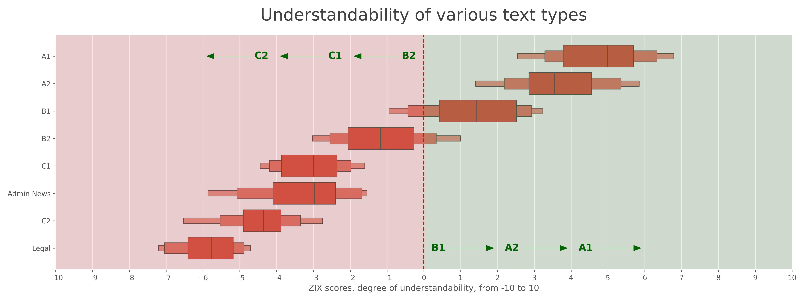
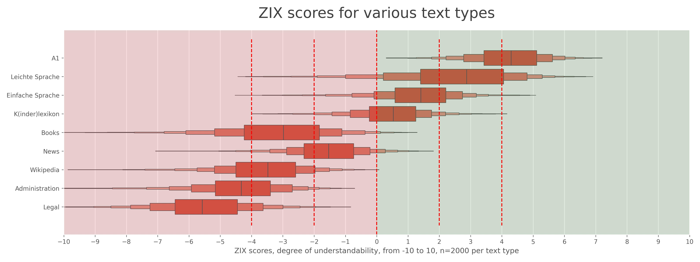

# Zürcher Verständlichkeitsindex (ZIX)

ZIX estimates how easy a German text is to understand. Use it to compare a
draft with a revision or to flag difficult passages for review.

## Usage

Add ZIX to a [uv](https://docs.astral.sh/uv/) project. The package requires
Python 3.11 or newer.

```bash
uv add git+https://github.com/machinelearningZH/zix_understandability-index
```

The trained model, scaler, and vocabulary files ship with the package.
Installation fetches the German spaCy model (`de_core_news_sm`). With the
dependencies installed, scoring runs locally without an API key.

```python
from zix import get_cefr, get_zix

text = "Das ist ein einfacher Text. Ich gehe spazieren. Die Sonne scheint. Es ist warm."
score = get_zix(text)
if score is not None:
    print(f"{score:.1f} ({get_cefr(score)})")
```

## Interpret the score

ZIX scores range from −10 to 10. Higher scores indicate easier text. Scores
of zero or higher map to B1 or easier. Negative scores map to B2 through C2.
`get_cefr()` maps the unrounded score to an approximate level.

| Approximate level | ZIX score |
| --- | --- |
| A1 | 4 and above |
| A2 | 2 to below 4 |
| B1 | 0 to below 2 |
| B2 | −2 to below 0 |
| C1 | −4 to below −2 |
| C2 | Below −4 |

[CEFR](https://www.coe.int/en/web/common-european-framework-reference-languages)
levels here are estimates. Use ZIX on German paragraphs and validate the score
on your own text types. Short phrases are unreliable. The scorer warns at five
words or fewer, returns `None` when it cannot derive features, and rejects
inputs over 1,000,000 characters.




## Method

A fitted ridge regression uses mean sentence length, a simplified RIX
(long tokens per sentence), a common-word score, and vocabulary overlap with
the Goethe-Institut's A1, A2, and B1 lists. The CEFR vocabularies use Swiss
Standard German spellings such as `ss` instead of `ß`. The model uses sentence
structure and vocabulary features. Plain and easy language rules such as
avoiding passive voice or the subjunctive require separate review.

The training targets are proxies. Synthetic texts use prompted A1–C2 levels.
Cantonal news is treated as C1, and court decisions are assigned a higher
difficulty than C2. These assumptions limit how precisely the model can
estimate CEFR levels.

## Development

From a repository checkout, install the locked development dependencies and
run the tests.

```bash
uv sync --locked
uv run pytest tests/
```

Install the notebook dependencies with `uv sync --locked --extra notebooks`.
Start with the [scoring example](05_use_zix.ipynb), or open it with
`uv run jupyter lab 05_use_zix.ipynb`.

The [dataset notebook](03_create_dataset.ipynb) combines the bundled inputs.
The [training notebook](04_create_zix.ipynb) records feature selection, outlier
filtering, and model fitting, and writes the scaler and regressor used by the
package. To refresh raw inputs, use the
[synthetic data notebook](01_create_cefr_data.ipynb), which reads
`OPENROUTER_API_KEY` from the environment or a local `.env`, or the
[cantonal news notebook](02_scrape_administrative_texts.ipynb), which fetches
pages from zh.ch.

## Project team

**Chantal Amrhein** and **Patrick Arnecke**,
[Amt für Statistik und Daten Zürich, Team Data](https://www.zh.ch/de/direktion-der-justiz-und-des-innern/amt-fuer-statistik-und-daten/data.html).

Send feedback to [datashop@statistik.zh.ch](mailto:datashop@statistik.zh.ch)
or open an issue or pull request.

## License

The software is licensed under the MIT License. See [LICENSE](LICENSE).
The cantonal text data is copyrighted and outside the MIT license.

## Disclaimer

This software (the Software) incorporates commercial and open-source models (the Models) from providers and libraries such as OpenRouter, spaCy, etc. The app was developed according to Swiss law and with the intent to be used under Swiss law. Please be aware that the EU Artificial Intelligence Act (EU AI Act) may, under certain circumstances, apply to your use of the Software. You are solely responsible for ensuring that your use of the Software and the underlying Models complies with all applicable local, national, and international laws and regulations. By using this Software, you acknowledge and agree (a) that it is your responsibility to assess which laws and regulations, in particular regarding the use of AI technologies, apply to your intended use and to comply with them, and (b) that you will hold us harmless from any action, claims, liability or loss in respect of your use of the Software.
